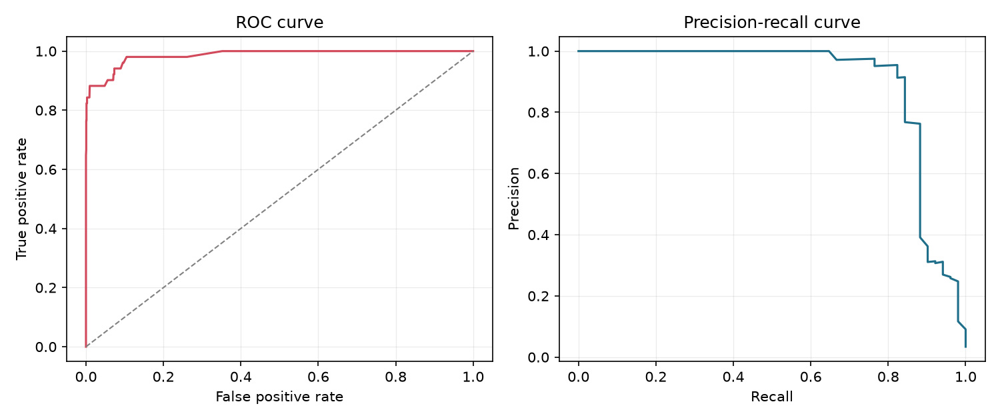
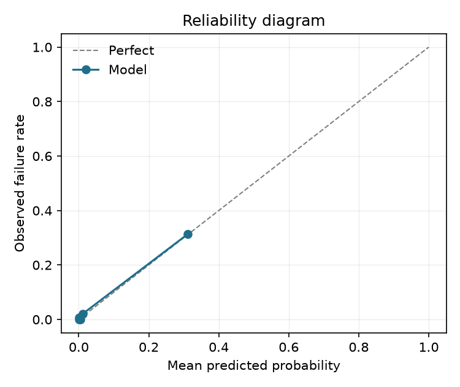
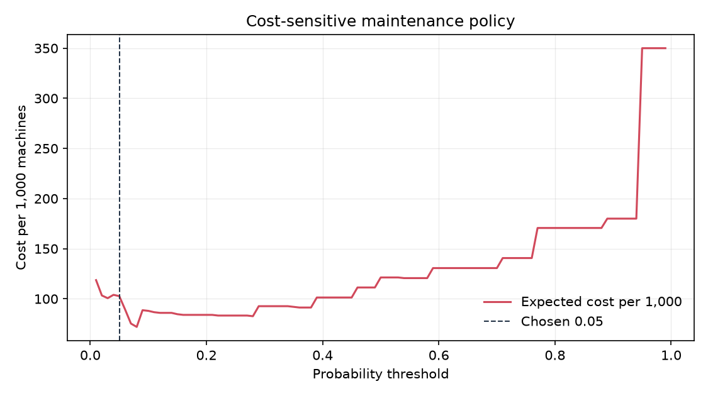
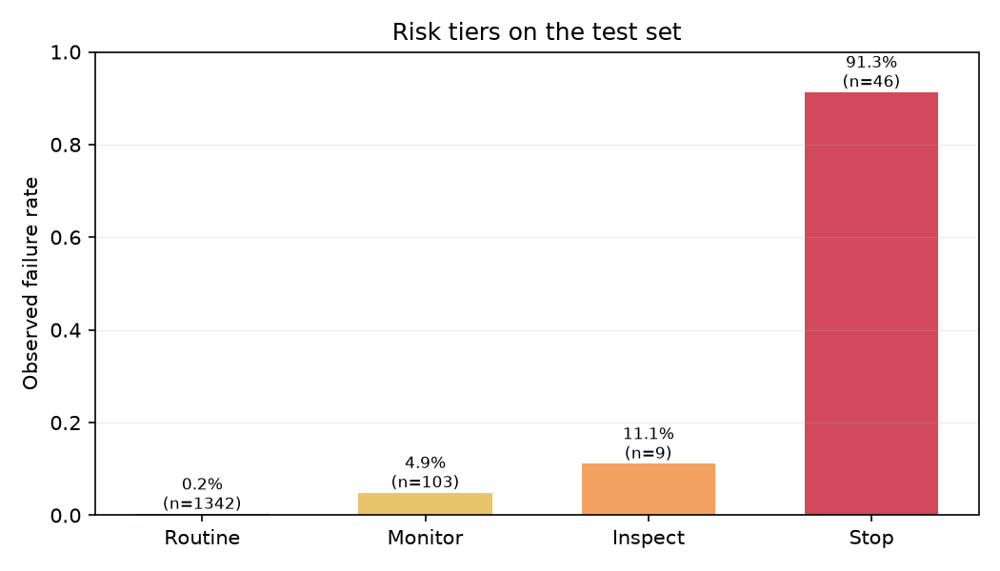
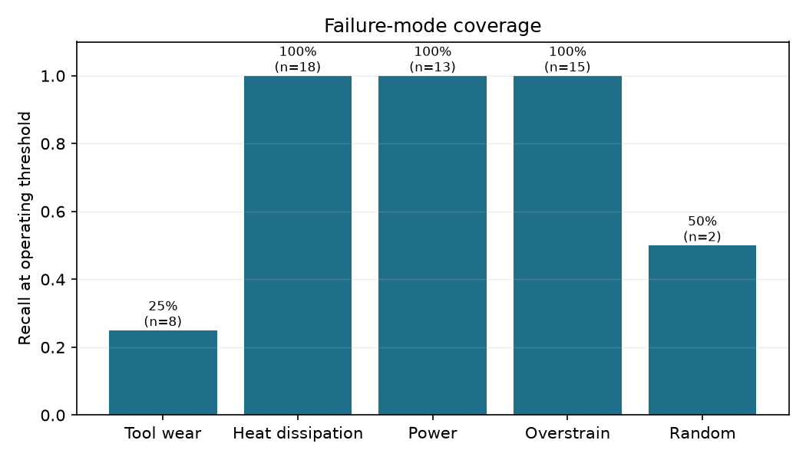
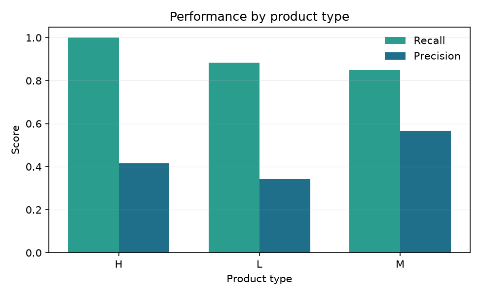
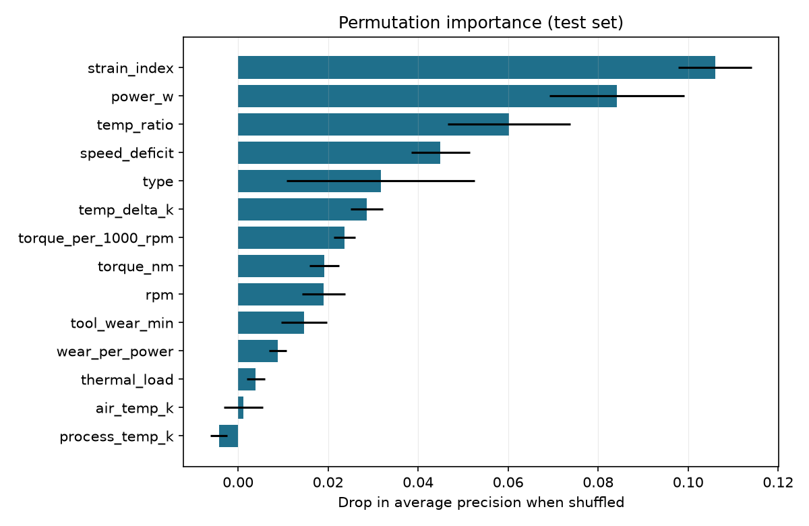

# Predictive Maintenance Pipeline

**Dataset:** AI4I 2020 predictive-maintenance benchmark - 10,000 machine observations, 339 failures (3.39%).
**Task:** flag an imminent machine failure from air/process temperature, rotational speed, torque and tool wear.
**Operating model:** random forest with isotonic calibration and a cost-sensitive maintenance threshold.

## 1. Executive summary

- Test-set **ROC-AUC 0.9858**, **PR-AUC 0.8967**, **recall 88.24%** and **precision 41.28%**.
- At the chosen threshold of **0.05**, **7.27%** of machines are flagged for inspection and **6** of 51 failures are missed.
- The policy minimises `15 x missed failure + 1 x false alarm`, giving an expected **65 cost units per 1,000 machines** on validation.
- Failure-mode coverage, product-type slices and calibrated risk tiers are reported so maintenance planners can see where the model is weak.

## 2. Dataset and splits

| Split | Machines | Failures | Failure rate |
| --- | ---: | ---: | ---: |
| Train | 7,000 | 237 | 3.39% |
| Validation | 1,500 | 51 | 3.40% |
| Test | 1,500 | 51 | 3.40% |

The split is stratified 70/15/15 with seed 42. The validation split selects the threshold; the test split is used once for final reporting. Duplicate rows are removed before splitting.

## 3. Method

1. **Cleaning:** normalise product type, validate sensor ranges, build tool-wear bands and remove duplicates.
2. **Physics-inspired features:** temperature delta, mechanical power, torque-wear strain index, torque per 1,000 rpm, wear per unit power, process/air temperature ratio, thermal load and speed deficit.
3. **Preprocessing:** median imputation and standard scaling for sensors; one-hot encoding for product type.
4. **Model selection:** 3-fold stratified CV over logistic regression, random forest, extra trees and histogram gradient boosting, ranked by PR-AUC.
5. **Calibration:** isotonic calibration of the winning pipeline.
6. **Maintenance policy:** choose the threshold on validation that minimises expected cost with a 15:1 missed-failure-to-false-alarm ratio.

### Model comparison

| model | pr_auc_mean | pr_auc_std | roc_auc_mean | roc_auc_std |
| --- | --- | --- | --- | --- |
| random_forest | 0.8694 | 0.0436 | 0.9712 | 0.0119 |
| hist_gradient_boosting | 0.8460 | 0.0362 | 0.9730 | 0.0121 |
| extra_trees | 0.8240 | 0.0337 | 0.9678 | 0.0036 |
| logistic_regression | 0.4700 | 0.0246 | 0.9302 | 0.0027 |

## 4. Test-set performance

| Metric | Value |
| --- | ---: |
| ROC-AUC | 0.9858 |
| PR-AUC | 0.8967 |
| Accuracy | 95.33% |
| Precision | 41.28% |
| Recall | 88.24% |
| F1 | 0.5625 |
| Brier score | 0.0074 |
| Log loss | 0.0336 |
| Flagged rate | 7.27% |
| Expected cost | 154 |

Confusion matrix: TN 1,385, FP 64, FN 6, TP 45.

The validation policy chose **0.05** with expected cost **65 per 1,000**. The test-optimal threshold would be 0.08 with cost 72; the difference is reported instead of retuning on test.





## 5. Maintenance policy

The policy curve translates every threshold into missed failures, false alarms and expected cost. A missed failure is 15x costlier than an unnecessary inspection. The selected threshold is a business decision, not only a statistical one.



## 6. Risk tiers

| tier | machines | failures | failure_rate |
| --- | --- | --- | --- |
| Routine | 1342 | 3 | 0.22% |
| Monitor | 103 | 5 | 4.85% |
| Inspect | 9 | 1 | 11.11% |
| Stop | 46 | 42 | 91.30% |



## 7. Failure-mode coverage

| mode | label | occurrences | detected | recall |
| --- | --- | --- | --- | --- |
| twf | Tool wear | 8 | 2 | 0.2500 |
| hdf | Heat dissipation | 18 | 18 | 1.0000 |
| pwf | Power | 13 | 13 | 1.0000 |
| osf | Overstrain | 15 | 15 | 1.0000 |
| rnf | Random | 2 | 1 | 0.5000 |



## 8. Operational slices

| slice | group | machines | failures | flag_rate | recall | precision | mean_score |
| --- | --- | --- | --- | --- | --- | --- | --- |
| type | H | 143 | 5 | 0.0839 | 1.0000 | 0.4167 | 0.0372 |
| type | L | 885 | 26 | 0.0757 | 0.8846 | 0.3433 | 0.0308 |
| type | M | 472 | 20 | 0.0636 | 0.8500 | 0.5667 | 0.0371 |
| tool_wear_band | 0-50 | 336 | 4 | 0.0208 | 1.0000 | 0.5714 | 0.0133 |
| tool_wear_band | 121-180 | 419 | 7 | 0.0310 | 1.0000 | 0.5385 | 0.0176 |
| tool_wear_band | 181-300 | 262 | 26 | 0.2710 | 0.7692 | 0.2817 | 0.0919 |
| tool_wear_band | 51-120 | 483 | 14 | 0.0373 | 1.0000 | 0.7778 | 0.0295 |



## 9. Feature importance

| feature | importance_mean | importance_std |
| --- | --- | --- |
| strain_index | 0.10599 | 0.00814 |
| power_w | 0.0842 | 0.01499 |
| temp_ratio | 0.0602 | 0.01361 |
| speed_deficit | 0.04497 | 0.00651 |
| type | 0.03166 | 0.02089 |
| temp_delta_k | 0.02859 | 0.00364 |
| torque_per_1000_rpm | 0.02364 | 0.00238 |
| torque_nm | 0.01916 | 0.00327 |



## 10. Limitations

- AI4I is a synthetic benchmark built around known failure rules; real sensor data is noisier and has different failure modes.
- The cost ratio is illustrative and should be replaced with downtime, repair and inspection economics.
- Only 10,000 observations are available, so subgroup estimates for rare failure modes are uncertain.
- The model predicts any failure, not the specific failure mode; maintenance crews still need diagnosis.
- No temporal validation: rows are shuffled, so sensor drift over time is not tested.

## 11. Reproducibility

```bash
python scripts/fetch_data.py
python -m maintenance.pipeline
python -m maintenance.cli check
streamlit run dashboard/app.py
```

All metrics, figures, predictions and the fitted model are regenerated from `data/raw/ai4i2020.csv`. Checksums are in `artifacts/manifest.json`.

## 12. Next steps

1. Add an out-of-time split and drift monitoring.
2. Train a multi-label model for the five failure modes.
3. Add remaining-useful-life regression on run-to-failure histories.
4. Calibrate the cost model with real maintenance records.
